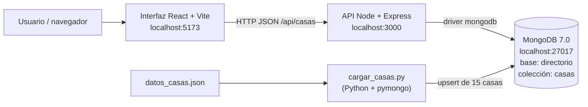

# Taller 1 C3 – Desarrollo de directorio con Mongo · Resumen técnico

> Documento de referencia del proyecto terminado. Fuentes revisadas el 25-oct-2026: `taller_final/` (paquete integrado), `taller_mongo/`, `taller_ui/` y el PDF del enunciado.
> Entrega: **miércoles 28-oct-2026**. Meta del equipo: todo listo el **martes 27-oct-2026**.

---

## 1. Resumen ejecutivo
- Aplicación web local que muestra un directorio de las **15 casas de software de Villavicencio** (Tabla 1 del enunciado).
- Tres piezas: **MongoDB** (base de datos) ← **API** Node/Express (puerto 3000) ← **Interfaz** React/Vite (puerto 5173). Un **script en Python** carga los datos.
- Funciona: búsqueda por nombre o parte del nombre (sin importar mayúsculas ni tildes), ficha resumen al estilo de la Figura 1, CRUD completo (crear, ver, editar, eliminar) y clic en la imagen → sitio oficial.
- Pruebas del API: todas pasan. **Falta probar** Docker Compose e `iniciar.bat` en el Windows de Julian.
- Datos: solo **5 de 15** casas tienen sitio oficial verificado; las otras 10 quedan sin sitio (`null`).

## 2. Requisitos del taller (según el PDF)
| # | Requisito | Dónde se cumple |
|---|---|---|
| 1 | App web conectada a MongoDB **local** | API → `mongodb://localhost:27017` |
| 2 | Interfaz gráfica para buscar por nombre o parte del nombre | Buscador de la UI + `GET /api/casas?q=` |
| 3 | Mostrar ficha resumen como la Figura 1 | `ui/src/components/FichaCasa.jsx` |
| 4 | Resto del CRUD | Botones Crear / Editar / Eliminar + rutas POST/PUT/DELETE |
| 5 | Clic en la imagen → página oficial | Imagen envuelta en enlace a `sitioWeb` (nueva pestaña) |
| 6 | (Recomendado) cargar datos con webscraping/automatización en Python | `carga/cargar_casas.py` (opción `--scrape`) |

## 3. Arquitectura

- La UI nunca habla directo con Mongo; todo pasa por la API.
- La UI tiene además un **modo mock** (`VITE_USE_MOCK=true`) que funciona sin API ni Mongo.

## 4. Tecnologías y versiones
| Parte | Tecnología | Versión (declarada) | Fuente |
|---|---|---|---|
| Base de datos | MongoDB (imagen Docker) | `mongo:7.0` | `docker-compose.yml` |
| API | Node.js | 18+ (requisito README) | `README.md` |
| API | express | ^5.3.0 | `api/package.json` |
| API | mongodb (driver) | ^7.7.0 | `api/package.json` |
| API | cors | ^2.8.6 | `api/package.json` |
| API (pruebas) | mongodb-memory-server ^11.3.0, supertest ^7.3.1, `node --test` | — | `api/package.json` |
| UI | react / react-dom | ^18.3.1 | `ui/package.json` |
| UI | vite ^5.4.11, @vitejs/plugin-react ^4.3.4 | — | `ui/package.json` |
| UI | CSS plano (sin framework) | — | `ui/README.md` |
| Carga | Python | 3.10+ | `README.md` |
| Carga | pymongo ≥4.6, requests ≥2.31, beautifulsoup4 ≥4.12, mongomock ≥4.1 (opcional) | — | `carga/requirements.txt` |

## 5. Modelo de datos y regla de normalización
Base `directorio`, colección `casas`. Índice **único** sobre `nombreBusqueda` (lo crean la API al arrancar y el script de carga).

| Campo | Tipo | Obligatorio | Nota |
|---|---|---|---|
| `_id` | ObjectId | auto | La API lo expone como `id` (texto) |
| `nombre` | texto | sí | Se recortan extremos y colapsan espacios |
| `direccion` | texto | sí | Igual |
| `especialidad` | texto | sí | Igual |
| `imagenUrl` | URL http(s) o `null` | no | `null` por defecto |
| `sitioWeb` | URL http(s) o `null` | no | `null` por defecto |
| `nombreBusqueda` | texto | calculado | Lo calcula la API/script; si el cliente lo envía se ignora |

**Regla de normalización** (idéntica en `api/src/normalizar.js` y `cargar_casas.py`):
1. Unicode **NFKD** y quitar todo lo no ASCII (quita tildes; ñ → n).
2. Pasar a **minúsculas**.
3. **Colapsar** espacios y recortar extremos.

Ejemplo: `"Ingesoft  Orinoquía"` → `"ingesoft orinoquia"`. Por eso `"ingesoft ORINOQUIA"` cuenta como duplicado (409).

## 6. Contrato de la API (v1 final)
Base: `http://localhost:3000`. Respuestas JSON; errores con forma `{"error":"mensaje"}`. CORS abierto.

| Método | Ruta | Qué hace | Éxito | Errores |
|---|---|---|---|---|
| GET | `/api/health` | Chequeo | 200 `{"status":"ok"}` | — |
| GET | `/api/casas` | Lista todas, ordenadas por `nombre` | 200 `[...]` | — |
| GET | `/api/casas?q=texto` | Búsqueda parcial normalizada (texto literal, no regex) | 200 `[...]` (o `[]`) | 400 si `q` no es texto (p. ej. `q[$ne]=x` o `q` repetido) |
| GET | `/api/casas/:id` | Una casa | 200 | 400 id inválido · 404 no existe |
| POST | `/api/casas` | Crea | 201 + casa | 400 validación/JSON inválido · 409 nombre duplicado |
| PUT | `/api/casas/:id` | **Reemplaza el documento completo** (`replaceOne`); campos omitidos quedan `null` | 200 + casa | 400 · 404 · 409 |
| DELETE | `/api/casas/:id` | Elimina | 204 sin cuerpo | 400 · 404 |
| * | otra ruta | — | — | 404 `Ruta no encontrada` |
| * | error interno | — | — | 500 `Error interno del servidor` |

Ejemplos:
```bash
curl "http://localhost:3000/api/casas?q=orinoquia"     # → [ { "nombre":"Ingesoft Orinoquía", ... } ]
curl -X POST http://localhost:3000/api/casas -H "Content-Type: application/json" \
  -d '{"nombre":"Casa Prueba","direccion":"Cra 1","especialidad":"Web"}'   # → 201
curl -X DELETE http://localhost:3000/api/casas/<id>     # → 204
```
Mensajes de error usados: `El campo 'nombre' es obligatorio`, `El campo 'sitioWeb' debe ser una URL http(s) o null`, `Id inválido`, `Casa no encontrada`, `Ya existe una casa con ese nombre`, `JSON inválido`, `El parametro q debe ser texto`.

## 7. Interfaz (UI)
**Funcionalidades**
- Buscador con espera de 300 ms; no distingue mayúsculas ni tildes.
- Lista de fichas; cada ficha: "EMPRESA 0N · ESPECIALIDAD", nombre, etiqueta (badge), Dirección sede principal, Tipo de productos y software, Sitio oficial, imagen.
- Crear / Editar (formulario en modal; editar envía siempre todos los campos) / Eliminar con confirmación.
- Clic en la imagen abre `sitioWeb` en pestaña nueva; sin sitio muestra «Sitio oficial no disponible».
- Muestra al usuario los mensajes de error de la API (400/404/409).

**Decisiones y diferencias frente al mockup (Figura 1)**
| Mockup | Implementado | Motivo |
|---|---|---|
| Caja «Números de contacto» | Caja **«Sitio oficial»** | No hay campo de teléfono en los datos |
| Etiqueta de categoría | Badge con la **primera parte de `especialidad`** (corta en `,` `&` `/`) | No existe campo categoría |
| Marco rosado de la imagen | Se conservó (`#ecd3cf`) | Fidelidad al mockup |
| Imagen siempre presente | **Placeholder SVG** si `imagenUrl` es `null` o falla | 11 casas sin imagen |
| — | Logo CODALTEC (webp transparente) sobre fondo gris-azul (`#e8eef5`) con `object-fit: contain` | Se veía mal sobre fondo transparente |

**Variables de entorno (`ui/.env`)**
| Variable | Defecto | Uso |
|---|---|---|
| `VITE_API_URL` | `http://localhost:3000` | URL de la API |
| `VITE_USE_MOCK` | `false` | `true` = 15 casas en memoria del navegador, sin backend (se reinicia al recargar). En mock, CODALTEC y Seobyte usan example.com/example.org como sitio **de ejemplo** |

## 8. Carga de datos
- Script: `carga/cargar_casas.py` (Jackson). Lee `datos_casas.json` (15 casas de la Tabla 1 + `nota` y `fuente`, que **no** se guardan en Mongo).
- **Idempotente**: `update_one(..., upsert=True)` por `nombreBusqueda`. Correrlo varias veces no duplica; imprime Insertados / Actualizados / Sin cambios / Total.
- Opciones: `--scrape` (intenta completar `imagenUrl` leyendo og:image o favicon del sitio; no inventa sitios), `--mock` (mongomock, sin servidor). Variable `MONGO_URI`.
- Fuente: Tabla 1 del taller + búsqueda web verificada con curl el 25-oct-2026.

| Casa | sitioWeb | imagenUrl | Estado |
|---|---|---|---|
| CODALTEC | codaltec.com | favicon 192px (.webp) | Verificado |
| SASOFTCO | sasoftco.com | og:image (logo) | Verificado |
| Ideas Software | ideasw.co | /favicon.ico | Verificado |
| Pegasus Software | web.colpegasus.com | `null` (favicon da 403) | **Dudoso** (ver §13) |
| Seobyte | seobyte.co | favicon | Verificado |
| Las otras 10 | `null` | `null` | Sin web oficial encontrada |

Total: 5 con `sitioWeb`, 4 con `imagenUrl`; 10 sin sitio y 11 sin imagen.

## 9. Cómo ejecutar
Requisitos: Docker Desktop abierto, Node.js 18+, Python 3.10+.

| Forma | Pasos |
|---|---|
| Windows rápido | Doble clic en `iniciar.bat` (levanta Mongo, carga datos, abre dos ventanas: API e Interfaz). Luego abrir http://localhost:5173 |
| Linux/Mac rápido | `./iniciar.sh` |
| Paso a paso | `docker compose up -d` → `cd carga && pip install -r requirements.txt && python cargar_casas.py` → `cd ../api && npm install && npm start` → `cd ../ui && npm install && npm run dev` |
| Sin Docker | Instalar MongoDB Community Server como servicio; misma URI `mongodb://localhost:27017` |

| Puerto | Servicio |
|---|---|
| 27017 | MongoDB (contenedor `directorio-mongo`, volumen `mongo_data`, healthcheck con mongosh) |
| 3000 | API (`PORT`) |
| 5173 | Interfaz (Vite) |

Variables: `MONGO_URI` (api y carga, defecto `mongodb://localhost:27017`), `PORT` (api, 3000), `VITE_API_URL`, `VITE_USE_MOCK`. En CMD de Windows: `set MONGO_URI=...` antes de `npm start`.
Comprobar: `/api/health` → `{"status":"ok"}`; `/api/casas` → 15; buscar `orinoquia` → «Ingesoft Orinoquía».
Reiniciar de cero: `docker compose down -v` y volver a cargar.

## 10. Estructura de carpetas (paquete final `taller_final/`, también `taller_final.zip`)
```
taller_final/
├── README.md            guía de arranque
├── docker-compose.yml   Mongo 7.0
├── iniciar.bat / iniciar.sh
├── carga/   cargar_casas.py, datos_casas.json, requirements.txt
├── api/     src/{server.js, app.js, normalizar.js}, test/api.test.js, README.md
└── ui/      src/{App.jsx, main.jsx, styles.css, api/{client,mockData,normalize}.js,
             components/{FichaCasa,FormCasa,Modal}.jsx, assets/placeholder.svg},
             screenshots/ (incl. mockup-figura1.png y api-real/), .env.example
```
Carpetas de trabajo originales: `taller_mongo/` (api, script, `infra/`, `pruebas/`) y `taller_ui/` (UI + `screenshots/paco/`).

## 11. Pruebas y resultados
| Quién | Qué | Resultado | Evidencia |
|---|---|---|---|
| Pedro | `npm test` (node --test + supertest + Mongo en memoria) | 9/9 | `api/test/api.test.js` (9 tests) |
| Paco | 55 casos contra la API (CRUD, búsqueda, tildes, inyección, duplicados, errores) + enlaces externos | 55/55 PASA; 9 URLs externas responden 200 | `taller_mongo/pruebas/INFORME.md`, `resultados.json`; repetir con `pruebas/correr_todo.sh` |
| Paco | Interfaz | 8/8 casos (reportado) | `taller_ui/screenshots/paco/` (ficha_codaltec.png, api_caida_tras_xyzxyz.png) |
| Juan | Integración extremo a extremo con mongod 7.0 real | OK (reportado) | — |

**No probado:** Docker Compose, `iniciar.bat` en el Windows de Julian, ventana angosta real (responsive), `--scrape`/`--mock` del script, CORS/concurrencia.

## 12. Decisiones tomadas
- `nombreBusqueda` normalizado + índice único → búsqueda sin tildes y evita duplicados (409).
- `q` se trata como texto literal (regex escapada); `q` no-texto → 400 (anti-inyección).
- PUT = reemplazo completo con `replaceOne`.
- La API devuelve `id` en vez de `_id`.
- Datos no verificables se dejan en `null`; no se inventan sitios ni imágenes.
- Carga idempotente por upsert.
- UI: «Sitio oficial» en vez de teléfonos; badge desde `especialidad`; placeholder; modo mock.

## 13. Pendientes y riesgos
| # | Pendiente / riesgo | Responsable sugerido |
|---|---|---|
| 1 | Probar `docker compose` e `iniciar.bat` en el Windows de Julian (8 GB RAM: cerrar programas pesados) | Julian / Juan |
| 2 | **Pegasus**: su web (Colpegasus) parece de gestión académica, no contabilidad/POS como dice la Tabla 1 → confirmar con el docente si se deja el enlace | Julian / docente |
| 3 | 10 casas sin sitio oficial: el clic en la imagen no redirige en esas | Aceptado / informar en entrega |
| 4 | Probar en ventana angosta real | Tulio / Paco |
| 5 | `iniciar.bat` instala paquetes con pip directo (no usa `requirements.txt`) y requiere Python/Node en el PATH | Juan |

## 14. Responsables
| Persona | Rol |
|---|---|
| Pedro | API Node + Express y revisión de código |
| Jackson | Script de carga `cargar_casas.py` y `datos_casas.json` |
| Tulio | Interfaz React + Vite |
| Juan | Docker Compose, README, integración |
| Paco | Pruebas (API y UI) |
| Ruby | Documento del proyecto aparte «corredor ecológico» |

## 15. Reutilizar la base para el corredor ecológico *(sugerencia)*
- Convertir `casas` en una colección genérica `entidades` con campo `categoria` (p. ej. especie, reserva, organización) en lugar de deducirla de `especialidad`.
- Mantener intactos: regla de normalización, índice único, contrato CRUD con `?q=`, upsert del script, modo mock y placeholder.
- Añadir filtros (`?categoria=`) y campos opcionales propios (coordenadas, contacto) sin romper el contrato.
- Cambiar solo `datos_*.json`, textos de la ficha y nombres de base/colección.
